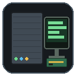

<h1> Computera 2: The New Era</h1>

[简体中文](README.md) · **English**

**Computera 2: The New Era** is a programmable computer and logistics automation addon for [IndustrialCraft²: The New Era](https://github.com/spectrum527/IndustrialCraft2-The-New-Era) that can also run standalone.

## Download and install

**The current stable release is 1.0.1.** Download `computera-1.0.1.jar` from Releases and place it in your NeoForge instance's `mods/` directory. In multiplayer, install the same JAR on both the client and the dedicated server. The `computera-1.0.1-package.zip` archive on the release page bundles the same JAR with a Chinese manual; do not put the ZIP file itself into `mods/`. Back up your worlds before upgrading. [Releases](https://github.com/MongolslingoNavy/computera-minecraft-mod/releases/tag/v1.0.1) · [Player guide (Chinese)](docs/README_zh.md) · [Implementation spec (Chinese)](docs/DESIGN.md)

| Minecraft | Mod loader | Java | Optional integration | Download |
| --- | --- | ---: | --- | --- |
| 26.1.2 | NeoForge 26.1.2.128 | 25 | IC2: The New Era 1.0.4+ | [NeoForge 26.1.2 JAR](https://github.com/MongolslingoNavy/computera-minecraft-mod/releases/tag/v1.0.1) |

A computer cluster starts with a Computer Cabinet. Each cabinet holds 8 compute card slots and 2 hard drive slots, and Compute Cards from tier I to V provide 2, 4, 8, 16, or 32 threads. Blocks connected by direct face contact or Data Cables in the same dimension form a single cluster, with a 64-block cable search range and a cap of 32 cabinets (up to 8,192 threads). Teletype Terminals run a text-only console that consumes Paper Tape at one line per output line (8,192 lines per roll). CRT Terminals draw 3 FE/t from the primary cabinet while viewed or running a program, and provide a multi-user scheduling screen where several players can share one thread and output stream or switch back to the text console. Terminals run a built-in Python-style scripting subset compiled to bytecode and share a cluster budget of 200,000 instructions per tick across active terminals. Programs live in cabinet memory or on Hard Drives (16 files per drive under `hd1:` and `hd2:`), and can be copied with Flash Modules or a Card Punch using Punched Cards. Craft the in-game Computera Manual for an 11-page walkthrough. [Player guide and terminal commands](docs/README_zh.md)

Any connected block that exposes standard NeoForge item or fluid capabilities registers under `devices` for scripts and GUIs. Right-clicking a cabinet with a Network Connector sets it as a hub, and right-clicking a distant container binds it to that cabinet without running cables. Logistics Ports attach to containers, accept right-click item filters, and build a cluster-wide item index for terminal commands (`count`, `find`, `store`, `take`, `ports`) and script calls (`logistics.count`, `logistics.find`, `logistics.ports`). Adding Logistics Pipes to the cluster moves items from unfiltered source ports to filter-matched destination ports in atomic transactions at 4 items per tick per pipe. The CRT Logistics tab supports full-stack, half-stack, and single-item mouse actions, container renaming and grouping, even distribution across selected containers, per-chest batch delivery, and timed move rules with an item icon picker. Clicking Native on the logistics tab opens a connected block's own GUI; version 1.0.1 anchors the server distance check to the terminal or display panel you used, so you can interact within 8 blocks of that anchor in the same dimension while the target block stays loaded and connected. Adjacent Crates placed face to face merge up to 64 blocks (27 slots each, up to 1,728 slots total) into one paged inventory with 54 slots per page; breaking one crate drops only its own 27 slots and regroups the remaining blocks. Network Displays mount on block sides, combine into a display wall when placed adjacent with the same facing, and refresh every 3 seconds (60 ticks) to show a cluster overview, item totals, or container working states. Right-clicking a display opens the cluster terminal GUI, and sneak-right-clicking opens the display status view. [Implementation spec and remote sessions](docs/DESIGN.md)

When installed alongside [IndustrialCraft²: The New Era](https://github.com/spectrum527/IndustrialCraft2-The-New-Era) on Minecraft 26.1.2, IC2 machines such as macerators, electric furnaces, compressors, and generators expose standard NeoForge item and fluid capabilities. Data cables, logistics ports, pipes, scripts, and display walls can read their inventories and tanks directly. Because IC2's EU grid is separate from NeoForge's standard FE capability, the EU Adapter connects to the IC2 energy network through runtime reflection without requiring IC2 at compile time and converts incoming EU to FE at `1 EU = 4 FE` (up to 32 EU per packet, 100,000 FE internal buffer). Each adapter outputs up to 1,000 FE/t and can power cabinets either by direct face contact or across connected data cables. If IC2 is not installed, the block still places normally and reports `not installed`. [Compatibility notes and power test](docs/README_zh.md#eu-适配器)

## Implementation boundaries, artwork and rights

The scripting engine is a custom bytecode virtual machine. It supports indentation blocks, conditionals, loops, functions, lists, dictionaries, and built-ins such as `sleep`, `time`, and `log`. It does not support `import`, classes, `try/except`, or third-party Python libraries. To keep resources conserved, container devices expose only `size`, `get`, `id`, `count`, and intra-container `move(from, to, n)`, and fluid devices expose read-only queries; older `put` and `take` calls that created or destroyed items without a source or destination are disabled and return a runtime error. Each terminal connected to a cluster occupies 1 thread, plus 1 additional thread while running a program. Cabinets do not generate power and currently charge no standby or per-thread energy cost, though losing power while a CRT terminal runs a script stops the program without auto-resume. Drones and custom sound effects are not included in this release. [Scripting and usage boundaries](docs/README_zh.md#脚本与使用边界)

Standard Gradle builds run a 63-case `scriptSelfTest` suite that checks the lexer, parser, compiler, and VM. Isolated server runs have verified cluster discovery, item conservation, crate merging and paging, concurrent FakePlayer terminal sessions, and remote native menu opening for vanilla chests, furnaces, and `ic2:generator`. Power integration was tested with IC2 1.0.4 by running a coal generator through a copper cable, an EU Adapter, and two data cables into a cabinet; the cabinet received 7,920 FE over 200 ticks, and power transfer stopped as soon as a cable was broken. Server-side FakePlayer checks do not replace visual verification on real clients or two-player LAN and server testing, and third-party blocks with custom opening protocols or extra distance checks are not guaranteed to work with remote native GUIs. All block textures, item icons, and cable models are generated procedurally by the Python scripts in `tools/` and use no third-party art assets. [Verification entry points](docs/DESIGN.md#验证入口)

**All Rights Reserved.** The source code in this repository is public for inspection only and is not distributed under an open-source license. No permission is granted to use, modify, or redistribute the code or assets without explicit authorization. Third-party dependencies follow their respective licenses.

## Build from source and feedback

Building from source requires JDK 25 and uses the included Gradle Wrapper. In `gradle.properties`, `org.gradle.java.installations.paths` is currently set to a local development path with `org.gradle.java.installations.auto-download=false`; before building on another machine, change that path to your JDK 25 installation or remove the line and point `JAVA_HOME` to JDK 25. `gradle/wrapper/gradle-wrapper.properties` and `settings.gradle` use mirror repositories by default and can be switched back to upstream URLs if a mirror is unreachable. The asset generation and preview scripts in `tools/` require Python and Pillow, and are not needed for regular Java builds.

Use `runClient` and `runServer` for development runs, or `runAuditClient` and `runAuditServer` for isolated verification under `build/audit-client` and `build/audit-server` (dedicated server runs require accepting the Minecraft EULA). The operator command `/computera selftest` places temporary blocks near the player and cleans them up after running, so use it only in a dedicated test world. When a compatible IC2 build is installed, `/computera selftestpower` tests live EU-to-FE power transfer across data cables. When reporting a bug, include your Minecraft, NeoForge, Computera 2, and related mod versions, reproduction steps, and sanitized logs without auth tokens, personal data, or private server addresses. [Report an issue](https://github.com/MongolslingoNavy/computera-minecraft-mod/issues)

```sh
# Linux / macOS: build JAR and run the 63-case scriptSelfTest suite
bash gradlew build

# Windows PowerShell: output is written to build/libs/computera-1.0.1.jar
.\gradlew.bat build
```
